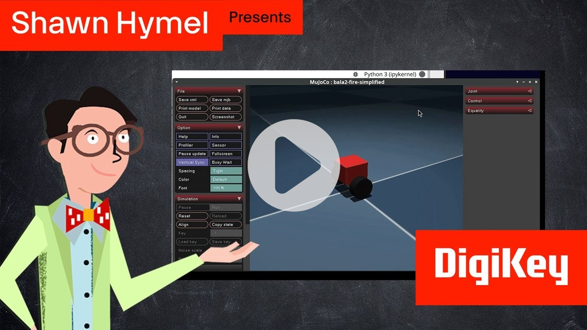
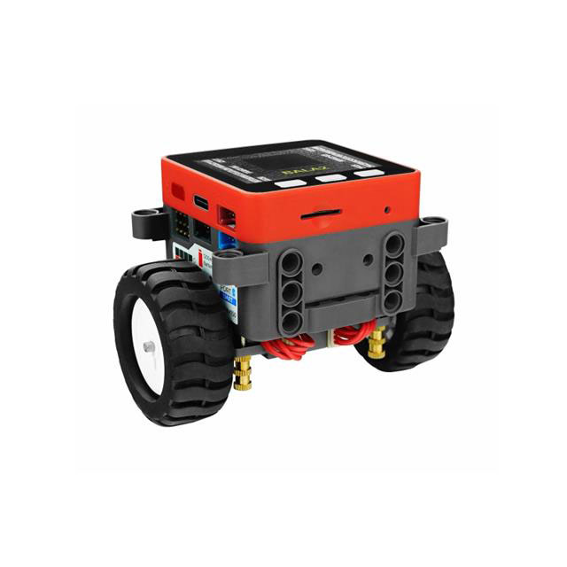
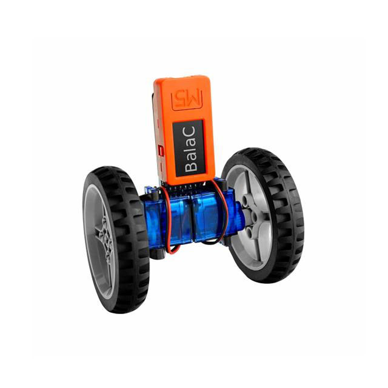

# Workshop: Reinforcement Learning for Robotics

Welcome to the Reinforcement Learning for Robotics workshop! We will work through the basics of converting a 3D CAD model of a robot to simulation, train a reinforcement learning (RL) agent using the PPO algorithm, and then deploy it to a real robot.

> If you are looking for the YouTube video series version of this demo, please use this repository: [github.com/ShawnHymel/reinforcement-learning-for-robotics](https://github.com/ShawnHymel/reinforcement-learning-for-robotics)

To dive deeper, I recommend checking out my full Reinforcement Learning for Robotics video series [here](https://www.youtube.com/watch?v=zsdceSTRBl4&list=PLYExBrZNJeQg&index=1).

  

## Get Started

This workshop has two paths. Choose the robot kit that you're working with in order to continue:

<table>
  <tr>
    <td>
      
    </td>
    <td>
      If you have the <a href="https://www.digikey.com/en/products/detail/m5stack-technology-co-ltd/K038-B/16679760">M5Stack Bala2 Fire kit</a>, click <a href="docs/bala2-tutorial.md">here to go to the tutorial</a>.
    </td>
  </tr>
  <tr>
    <td>
      
    </td>
    <td>
      If you have the <a href="https://www.digikey.com/en/products/detail/m5stack-technology-co-ltd/K014-E/16679752">M5Stack Bala-C Plus kit</a>, click <a href="docs/bala-c-tutorial.md">here to go to the tutorial</a>.
    </td>
  <tr>
</table>

## License

All software in this repository, unless otherwise noted, is licensed under the [Apache-2.0](https://www.apache.org/licenses/LICENSE-2.0) license.

This README document, all included images, and the slides are licensed under [Creative Commons Attribution 4.0 International (CC BY 4.0)](https://creativecommons.org/licenses/by/4.0/deed.en).
