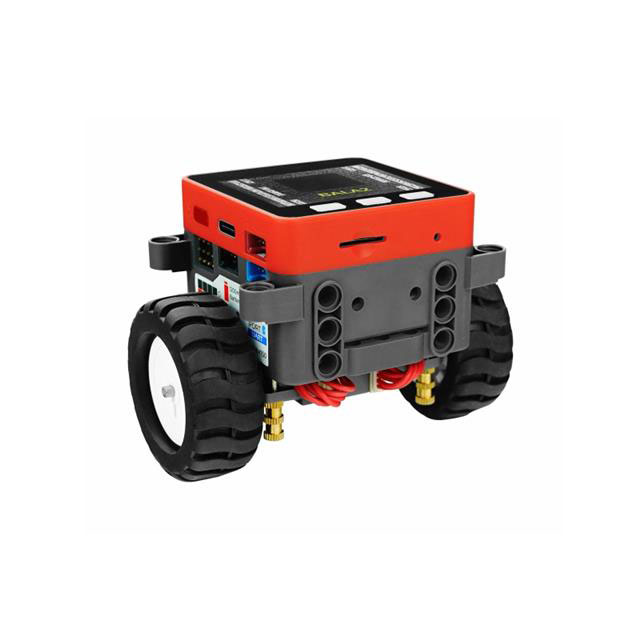
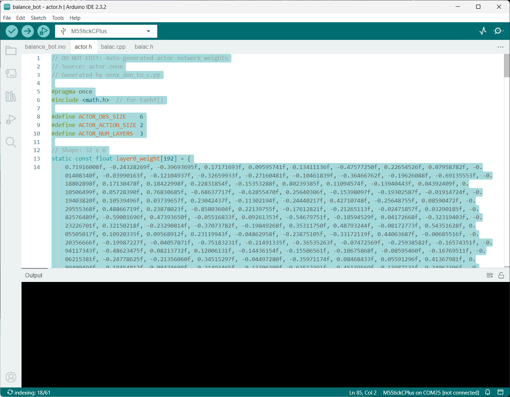

# Bala2 Fire Balance Bot Tutorial

<p align="center">
    
<p align="center">

Welcome to the Reinforcement Learning for Robotics workshop for the [Bala2 Fire balance bot](https://www.digikey.com/en/products/detail/m5stack-technology-co-ltd/K014-E/16679752).

## Training

We start by training a reinforcement learning agent from scratch. Navigate to this [pre-made training Notebook in Colab](https://colab.research.google.com/github/shawnhymel/workshop-reinforcement-learning-for-robotics/blob/main/workspace/software/python/rl_train_bala2.ipynb).

Press `shift+enter` to run each cell in a sequence. Feel free to read throguh the cells to figure out what's going on.

## Deployment

The last few cells in the training notebook convert the trained AI agent to pure C code (in an *actor.h* file). Find this file on your host computer. It should be in the most recent *workshop/software/python/output/* folder. Right-click on the file and select **Download**.

%%%Screen: actor.h location

Copy the downloaded *actor.h* file and paste it into the *workspace/software/arduino/balance_bot_bala2/* folder, choose to overwrite the existing *actor.h*.

Download and install the [Arduino IDE](https://www.arduino.cc/en/software/).

Open *workspace/software/arduino/balance_bot_bala2/balance_bot_bala2.ino* in the Arduino IDE.

> Note: *actor.h* contains your trained RL agent (just the actor part of the actor-critic agent). It is a relatively simple neural network that takes in the observation vector and outputs the recommended action for each motor. Because it's simple enough, we just perform inference directly in the CPU using basic multiplications, additions, and tanh functions (no SIMD, GPU, or NPU acceleration). Feel free to look through the actor.h file to see how we're doing this.



Go to **File > Preferences**. Add the following URL to the *Additional boardss manager URLs* list:

```
https://static-cdn.m5stack.com/resource/arduino/package_m5stack_index.json
```

Click **OK** and let the new board definition install.

In the *Library Manager*, search for and install the following libraries:

 * **M5GFX**
 * **M5Unified**

Connect the balance bot to your computer using a USB cable. Upload the *balance_bot_bala2.ino* sketch to the robot. Once complete, unplug the USB cable from the robot, carefully set the robot upright on a smooth, level surface, and let it go.

> **Note**: The M5Stack Bala-C does not include encoders on the motors or wheels. As a result, it will struggle to stay upright in one place. The 3-phase training cycle does a decent job at including estimated position and heading information, but it's far form perfect. The more expensive [Bala2 Fire](https://www.digikey.com/en/products/detail/m5stack-technology-co-ltd/K014-E/16679752) includes encoders and does a much better job at balancing. I use the Bala2 Fire in the video series for this reason.