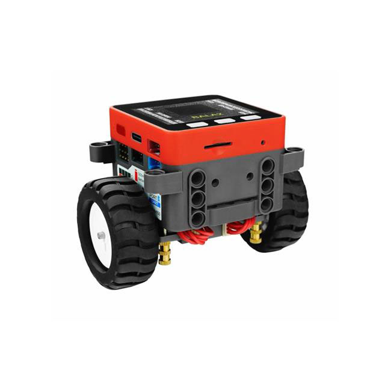
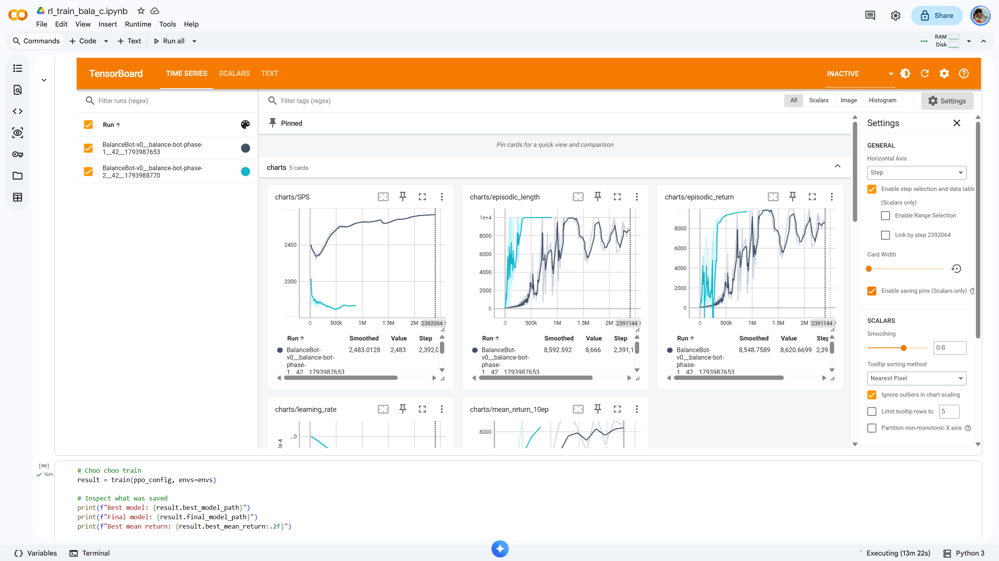
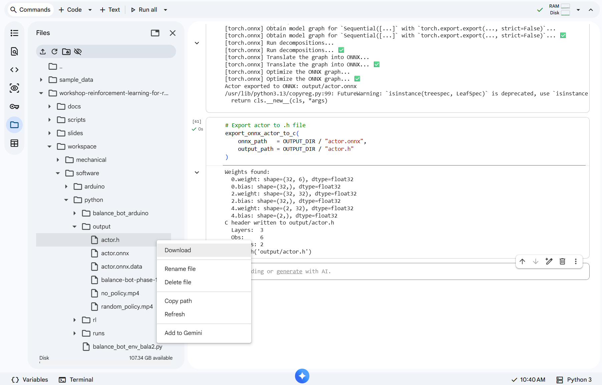
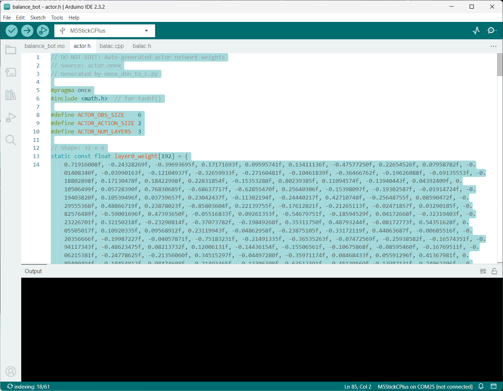
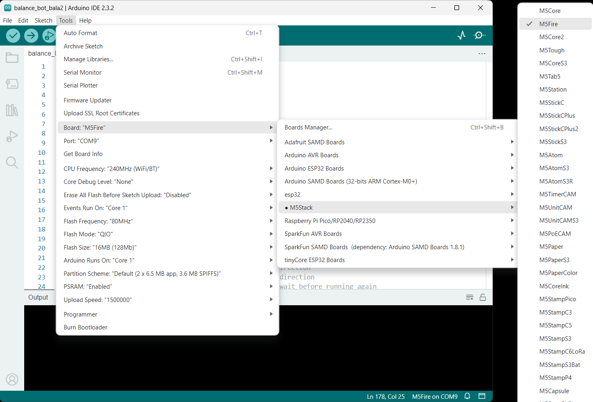
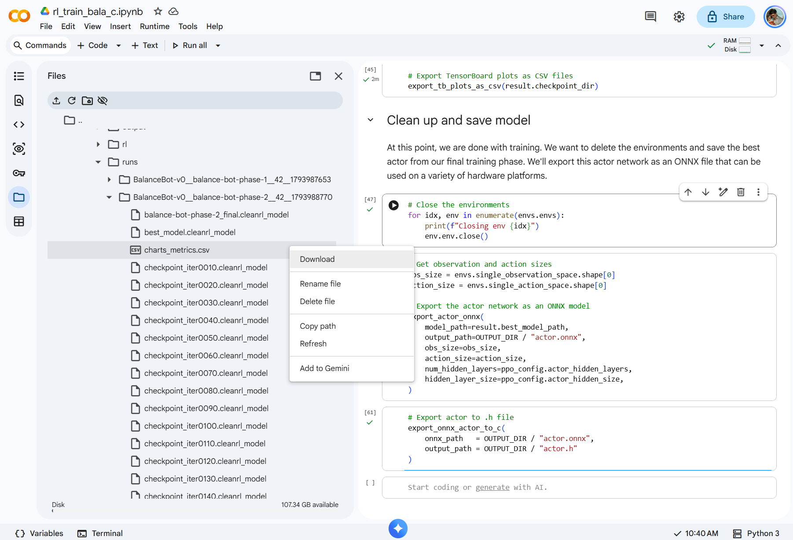

# Bala2 Fire Balance Bot Tutorial

<p align="center">
    
<p align="center">

Welcome to the Reinforcement Learning for Robotics workshop for the [Bala2 Fire balance bot](https://www.digikey.com/en/products/detail/m5stack-technology-co-ltd/K014-E/16679752).

## Training

We start by training a reinforcement learning agent from scratch. Navigate to this [pre-made training Notebook in Colab](https://colab.research.google.com/github/shawnhymel/workshop-reinforcement-learning-for-robotics/blob/main/workspace/software/python/rl_train_bala2.ipynb).

Press `shift+enter` to run each cell in a sequence. Feel free to read throguh the cells to figure out what's going on.

> Note: We are running the training sequence twice. In the first phase, we are just trying to get the robot to balance using the ideal simulation parameters. In the second phase, we introduce *domain randomization* (DR), where we randomly vary different aspects of the robot and environment (e.g. mass, sensor noise, motor noise, etc.). This is what helps create a robust policy: rather than trying to perfectly model the robot, sensors, actuators, etc. in simulation, we have the agent learn to deal with variations and noise.

During training, you can press the refresn on the TensorBoard cell to update the charts.



Here are the charts you should care about:

 * **charts/episodic_return**: Total actual rewards from completed episodes (this is the most important chart that describes how well the agent is doing over the training run: you want this to max out at 1000 for many timesteps)
 * **charts/episodic_length**: Episode length (timesteps) from completed episodes
 * **losses/entropy**: Spread of action probabilities from actor NN. Shows how much actor is committing to actions (explore vs. exploit)
 * **losses/explained_variance**: Compare critic vs. actual returns (you want this to be close to 1.0)
 * **losses/approx_kl**: KL divergence, which tells how far the policy’s action distribution has moved from the policy that collected the batch (~0.01-0.02 is healthy)
 * **losses/clipfrac**: Fraction of samples whose probability ratio (new policy vs. old) moved beyond +/-20%  (~0.1–0.3 is healthy)

## Deployment

The last few cells in the training notebook convert the trained AI agent to pure C code (in an *actor.h* file). Find this file on your host computer. It should be in the most recent *workshop/software/python/output/* folder. Right-click on the file and select **Download**.



Copy the downloaded *actor.h* file and paste it into the *workspace/software/arduino/balance_bot_bala2/* folder, choose to overwrite the existing *actor.h*.

Download and install the [Arduino IDE](https://www.arduino.cc/en/software/).

Open *workspace/software/arduino/balance_bot_bala2/balance_bot_bala2.ino* in the Arduino IDE.

> Note: *actor.h* contains your trained RL agent (just the actor part of the actor-critic agent). It is a relatively simple neural network that takes in the observation vector and outputs the recommended action for each motor. Because it's simple enough, we just perform inference directly in the CPU using basic multiplications, additions, and tanh functions (no SIMD, GPU, or NPU acceleration). Feel free to look through the actor.h file to see how we're doing this.



Go to **File > Preferences**. Add the following URL to the *Additional boardss manager URLs* list:

```
https://static-cdn.m5stack.com/resource/arduino/package_m5stack_index.json
```

Click **OK** and let the new board definition install.

In the *Library Manager*, search for and install the following libraries:

 * **M5GFX**
 * **M5Unified**

Connect the balance bot to your computer using a USB cable. Go to **Tools > Board > M5Stack** and select the **M5Fire** board option. Select the serial port associated with your robot.



Press the **Upload** button to compile and upload the sketch to the robot. Once complete, unplug the USB cable from the robot, carefully set the robot upright on a smooth, level surface, and let it go.

## Going Further

If your robot is not balancing (despite balancing in simulation), you've hit the *sim-to-real* gap. In other words, things work in simulation but not in the real world. This is due to a variety of possible reasons, including inaccurate modeling (e.g. no tire ridges), sensor or actuator noise, timing or implementation mismatches, bad calibration, and so on.

There are a few ways to combat the sim-to-real gap. The first is to tune some of the `// Settings` parameters in the Arduino firmware. If you find that your robot is slowly drifting forward or backward, try changing `PITCH_OFFSET`. If the motors are too jerky, try lowering `MOTOR_BOOST`.

The other option is to introduce other domain randomization settings, add more training phases (if necessary), and train your agent again. This is a good place to get AI to help you figure out where to apply DR: in Colab (after running through all the training cells), navigate to `workspace/software/python/runs/`, go into one or both of the runs for the phases, and download `charts_metrics.csv` and `losses_metrics.csv`. These are the CSV versions of the TensorBoard charts, which LLMs can read more easily than e.g. screenshots. Note that if you download them from both phases, you'll need to rename the files to reflect which phase they came from.



Upload these CSV files along with the code from this repository to your favorite AI tool (e.g. Claude), tell it which balance bot you're using, and describe the behavior you're seeing on the real robot. It should walk you through some diagnostics and help you modify the parameters or DR code.

You can also try asking it to design a new behavior, like spinning in a circle or adding remote control (e.g. WiFi access point and web page).

Happy hacking!